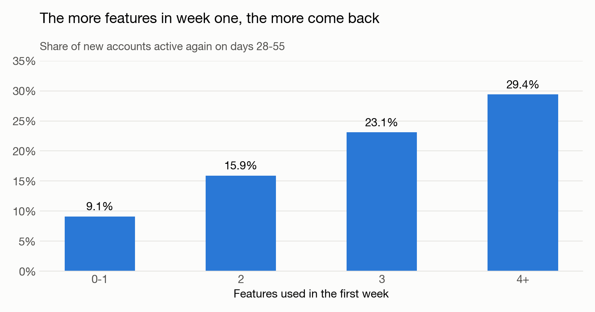
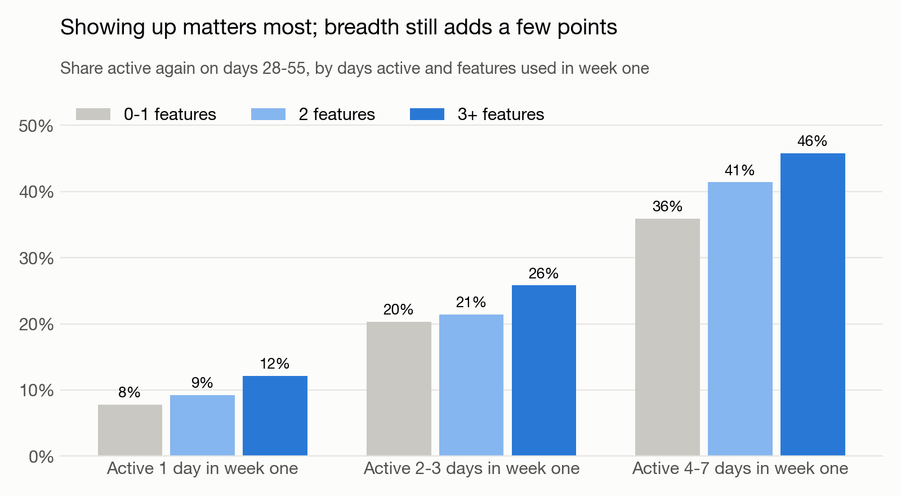
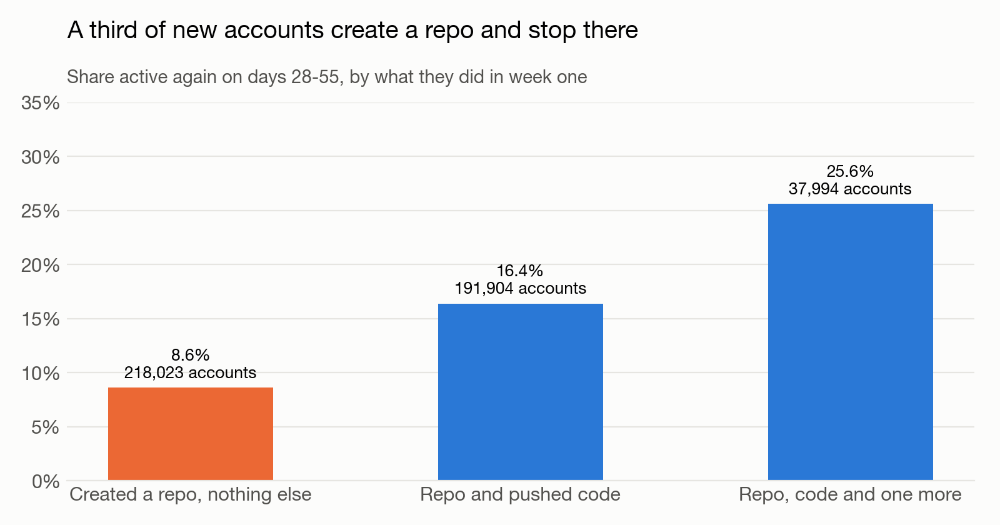
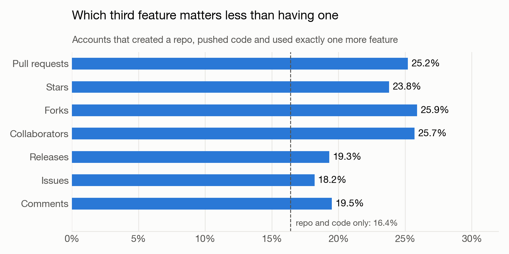

# Do people who try more features in their first week come back?

An onboarding question on real SaaS usage data: 626,616 new GitHub accounts, what they
did in their first week, and whether they were still around a month later.

**Skill on show: Python.** One notebook in pandas: `groupby`, `cut`, `crosstab`, a cohort
check, four matplotlib charts and a sample-size calculation for the test I'd run. DuckDB
does the heavy lifting over 96 days and 352 million raw events in about three seconds.

**The answer in one line:** yes. 9% of people who use one feature come back, against
29% of those who use four or more. But showing up on more than one day matters even
more, and the biggest group to fix is the 35% of new accounts that create a repository
and stop there.



## Business problem

GitHub has many features: repositories, pushing code, pull requests, issues, stars,
forks. Most new accounts touch one or two of them and leave. An onboarding team wants to
know which first steps go with people sticking around, so it knows what to nudge new
users towards.

## Data

Every public GitHub event from [GH Archive](https://www.gharchive.org), June to
September 2025: about 3.7 million events a day, each with an account id, a type and a time.

- **New account:** registered between 2 and 29 June 2025 and did something public within
  two weeks. GH Archive has no sign-up date, but GitHub hands out account ids in order,
  so each sign-up week is a known range of ids ([`src/signup_weeks.csv`](src/signup_weeks.csv),
  found by checking ids against the GitHub API).
- **Week one:** the 7 days starting with the account's first public action.
- **Features:** the 11 product areas an event belongs to, for example pushing code,
  creating a repository or branch, opening a pull request, starring.
- **Came back:** any public activity on days 28 to 55, the account's second month.
- **Not people:** 714 accounts GitHub marks as bots and 447 that posted more than 200
  events on a single day are left out.

**One caveat.** GH Archive only sees public activity. Someone who keeps working in
private repositories looks like they never came back, so every rate here is a floor.

## Process

1. [`src/extract.py`](src/extract.py) downloads GH Archive one hour at a time and keeps
   one small Parquet file per day.
2. [`src/build.py`](src/build.py) turns 96 days of events into one row per new account:
   first action, days active and features used in week one, and whether it came back.
3. [`notebooks/feature_retention.ipynb`](notebooks/feature_retention.ipynb) does the
   analysis, one question per section. The notebook is generated from
   `feature_retention.py`, so the code also reads as a plain script.

## Insights

1. **About one new account in eight comes back.** 12.6% of 626,616 are active again in
   their second month, and every sign-up week looks the same.
2. **More features in week one, more come back.** 9.1% for zero or one feature, 15.9% for
   two, 23.1% for three, 29.4% for four or more. But 57% of new accounts use one feature
   at most, and only 7% use three or more.
3. **Showing up matters most.** People active on one day in week one come back 8–12% of
   the time, those active on four to seven days 36–46%. At the same number of days, three
   or more features still add 4 to 10 points over one.

   

4. **A third of new accounts create a repository and stop.** 218,023 accounts, 35%,
   created a repository or branch and did nothing else public in week one. 8.6% of them
   came back, against 16.4% for those who also pushed code and 25.6% for those who did one
   more thing on top.

   

5. **The third feature doesn't need to be a particular one.** Pull requests, stars, forks
   and collaborators all land at 24–26%; issues, comments and releases at 18–19%. Every
   one of them beats stopping at repository and code.

   

## Recommendation

**Get people from "created a repository" to "pushed code", and bring them back on a
second day.** Right after a repository is created, show how to push the first commit,
and send one reminder a day or two later. That aims at both signals at once: a second
feature and a second active day.

This data shows who comes back, not what makes them come back, so I'd test it.

- **Who:** new accounts that created a repository and haven't pushed within 24 hours.
- **Control:** today's experience. **Treatment:** the first-push guide and a reminder.
- **Main metric:** active again on days 28–55. Today it's 8.6% for this group.
- **Also watch:** pushed code within week one.
- **Size:** about 5,900 accounts per group to see a lift from 8.6% to 10.1% (5%
  significance, 80% power). Around 54,500 such accounts sign up every week, so one week of
  sign-ups is enough; the wait is the two months until the outcome is known.

## Run it yourself

```bash
pip install -r requirements.txt
python src/extract.py 2025-06-02:2025-09-05     # downloads ~1 GB a day, keeps ~120 MB
python src/build.py
jupyter nbconvert --to notebook --execute --inplace notebooks/feature_retention.ipynb
```
